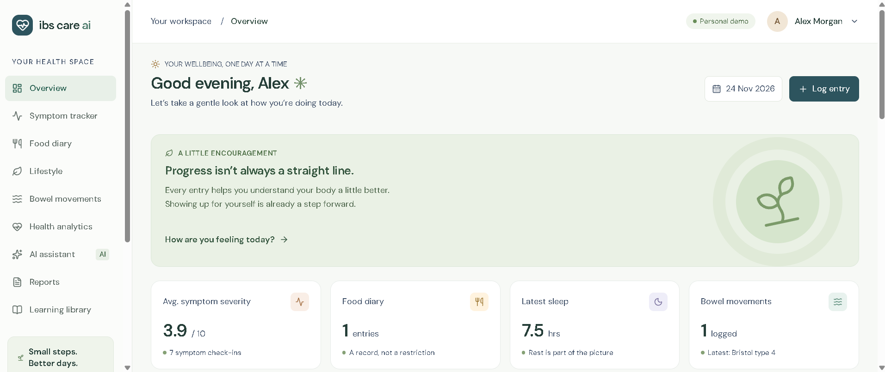

# IBS Care AI

**Educational synthetic-data diary demonstration** for tracking symptoms, food, lifestyle, and bowel patterns — with charts, export, and a simple educational chat.

> ⚠️ **Not a production healthcare product.**
> Do **not** enter real patient, personal, or health data. This is a runnable demo only.

---

## Screenshots

### Application Overview


### Application Dashboard



---

## What This Project Includes

| Layer | Stack |
|---|---|
| Frontend | React 19, Vite, TypeScript, Tailwind CSS v4, Recharts |
| Backend | Java 21, Spring Boot REST API |
| Database | MySQL 8 + Flyway migrations |
| AI Service | Python / FastAPI (private K-Means clustering) |
| Runtime | Docker Compose (4 services) |

### Features That Work

- Responsive overview + symptom / food / lifestyle / bowel diaries
- Time-filtered charts
- Validated add / delete forms
- CSV export and browser print-to-PDF
- Country, timezone, and unit preferences (browser-local)
- Educational library + deterministic educational chat (not an LLM)
- **Figma / static preview:** Entries stored in `localStorage`
- **Docker mode:** Frontend → Spring Boot → MySQL persistence
- Java unit tests and Python tests run during image builds

### Important Limitations

- The Docker diary is **public and shared** — anyone can list, add, and delete synthetic entries.
- No registration, authentication, patient ownership, roles, consent, audit trail, encryption, or compliance claims.
- Lifestyle = sleep value + notes; food = title + notes (not normalized ingredients).
- Python clustering API is internal only; the frontend does not call it yet.
- This is a **demonstration**, not a finished clinical platform.

---

## Prerequisites

**Recommended:** Docker Engine / Desktop with Compose v2 and at least 4 GB free memory.

Docker supplies Java 21, Maven, Node 22, MySQL 8, and Python 3.12.

**Frontend-only local work:** Node 22 + Corepack / pnpm.

---

## Quick Start (All Services)

```bash
# 1. Clone the repository
git clone <your-repo-url>
cd <repo-name>

# 2. Create environment file
cp .env.example .env

# 3. Generate two strong, distinct passwords and put them in .env
openssl rand -hex 32   # DB_PASSWORD
openssl rand -hex 32   # DB_ROOT_PASSWORD

# 4. Build and start all services
docker compose up --build -d

# 5. Watch backend logs until the application has started
docker compose logs -f backend
